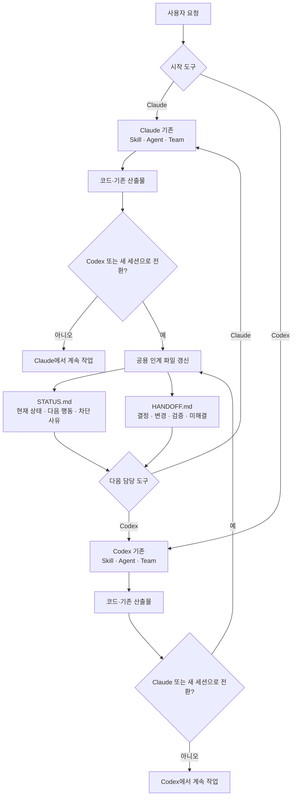
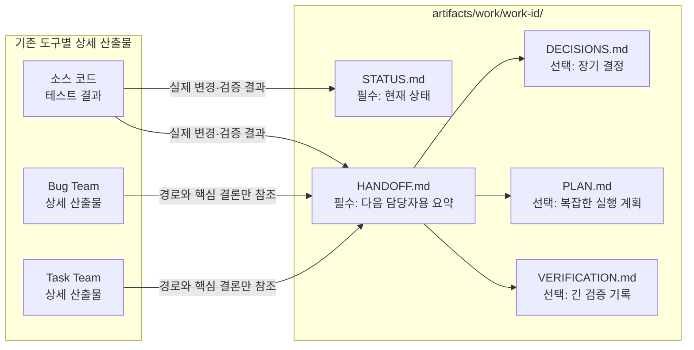

# Claude-Codex 공유 산출물 하네스

Claude와 Codex는 각 도구의 기존 Agent, Skill, Team 흐름으로 독립적으로 작업하고, 다른 도구 또는 새 세션이 실제로 이어받아야 할 때만 파일 기반 인계 계약을 사용한다.

## 전체 흐름

## 인계 시 읽고 쓰는 파일

`task-team`과 `bug-team`의 내용을 공용 폴더에 복사하지 않는다. 다음 도구가 필요한 상세 문서만 `HANDOFF.md`에서 경로로 참조한다.

| 다이어그램 노드       | 실제 경로 또는 내용                                             |
| --------------------- | --------------------------------------------------------------- |
| Task Team 상세 산출물 | `artifacts/task-team/{run id}/`의 요구사항·명세·리뷰·QA         |
| Bug Team 상세 산출물  | `artifacts/bug-team/{run id}/`의 ticket·localize·fix·postmortem |
| 소스 코드·테스트 결과 | 현재 작업 트리의 변경과 실제 검증 결과                          |

## 파일 지도

| 역할                    | Claude                                                             | Codex                                         |
| ----------------------- | ------------------------------------------------------------------ | --------------------------------------------- |
| 입구                    | `CLAUDE.md`                                                        | `AGENTS.md`                                   |
| 공용 규칙               | `.claude/rules/*.md` → `docs/agent-rules/` 심볼릭 링크             | `docs/agent-rules/` 직접 읽기                 |
| 팀원                    | `.claude/agents/*.md`                                              | `.codex/agents/*.toml`                        |
| Skill                   | `.claude/skills/**`                                                | `.agents/skills/**`                           |
| Hook                    | `.claude/hooks/*.sh` + `.claude/settings.json`                     | `.codex/hooks/*.sh` + `.codex/hooks.json`     |
| 인계 Skill              | `.claude/skills/cross-agent-handoff/SKILL.md`                      | `.agents/skills/cross-agent-handoff/SKILL.md` |
| 인계 절차 (단일 원본)   | `docs/agent-contracts/handoff.md`                                  | 같음                                          |
| 인계 파일 계약 · 템플릿 | `artifacts/work/README.md`, `artifacts/work/work-item-template.md` | 같음                                          |

쌍 파일은 `scripts/check-agent-harness-sync.sh`(pre-commit, lint-staged)가 한쪽만 staged된 커밋을 막는다.

## 운영 규칙

1. Claude와 Codex 중 어느 쪽에서 시작해도 동일하다.
2. 같은 도구·세션에서 계속 작업하면 공용 인계 파일을 만들지 않는다.
3. 모델 또는 세션을 넘길 때만 `cross-agent-handoff`를 사용한다.
4. `STATUS.md`와 `HANDOFF.md`는 인계 시 필수다. 나머지 파일은 필요할 때만 추가한다.
5. 배포, 외부 발송, 삭제, 병합 충돌, 테스트 실패는 사람 승인 또는 명시적 미해결 상태로 남긴다.
